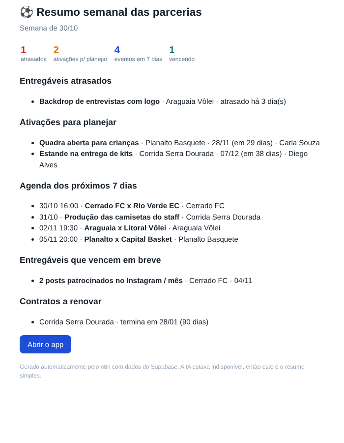

# Automação n8n: resumo semanal das parcerias

Toda segunda-feira às 8h (horário de Brasília), o fluxo busca os dados do Supabase, pede ao Claude um resumo da semana e envia por e-mail para o time.

```
Toda segunda 8h ─┐
                 ├─► Configurações ─► Buscar dados no Supabase ─► Montar pedido ─► Claude: escrever resumo ─► Montar e-mail ─► Enviar e-mail
Executar manual ─┘                    (RPC weekly_digest)                          (Messages API)               (HTML seguro)
```

O e-mail traz:
- **Prioridades**: entregáveis atrasados e ativações que ainda não saíram do planejamento a menos de 45 dias
- **Agenda** dos próximos 7 dias
- **Entregáveis** que vencem em breve
- **Contratos** que terminam nos próximos 90 dias



## Decisões de projeto

- **Uma chamada ao banco**: a função SQL `weekly_digest()` (em `supabase/schema.sql`) junta tudo num JSON, usando as views do app. O fluxo não precisa saber o formato das tabelas.
- **A IA só escreve, não decide**: o prompt manda usar apenas os dados recebidos. O HTML gerado passa por uma lista de tags permitidas antes de ir para o e-mail.
- **Funciona mesmo se a IA falhar**: o nó do Claude tenta 2 vezes. Se ainda falhar, o e-mail é montado direto dos dados, sem texto da IA, e avisa isso no rodapé.
- **Chaves fora do fluxo**: Supabase, Anthropic e e-mail ficam nas credenciais do n8n. O arquivo JSON não tem nenhum segredo.

## Como instalar

1. **Banco**: rode a versão mais recente de `supabase/schema.sql` no SQL Editor do Supabase (cria a função `weekly_digest`).
2. **Importar**: no n8n, **Workflows → Import from File** → `n8n/resumo-semanal.json`.
3. **Credenciais** (o n8n pede ao abrir os nós):

   | Nó | Tipo de credencial | O que preencher |
   |---|---|---|
   | Buscar dados no Supabase | Supabase API | Host: `https://SEU-PROJETO.supabase.co` · Service Role Secret: chave **service_role** (Project Settings → API Keys) |
   | Claude: escrever resumo | Header Auth | Name: `x-api-key` · Value: sua chave da API da Anthropic |
   | Enviar e-mail ao time | SMTP | Servidor do seu e-mail (no Gmail: `smtp.gmail.com`, porta 465, SSL, com senha de app) |

   A chave *service_role* ignora o RLS, por isso fica **só** nas credenciais do n8n, nunca no front-end ou no GitHub.
4. **Configurações**: no nó *Configurações*, troque `email_to` e `email_from` pelos e-mails do time.
5. **Testar**: clique em **Execute workflow**. Se o e-mail chegar, ative o fluxo (*Active*).

## Testes

O fluxo foi executado no n8n 2.43 com a função `weekly_digest()` rodando num PostgreSQL local e com a API do Claude e o servidor de e-mail simulados, nos cenários:
- dados reais da função `weekly_digest()` com o `seed.sql`
- resposta do Claude com HTML indevido (`<script>`, atributos), que é removido
- Claude indisponível, quando o e-mail é enviado no modo simples
